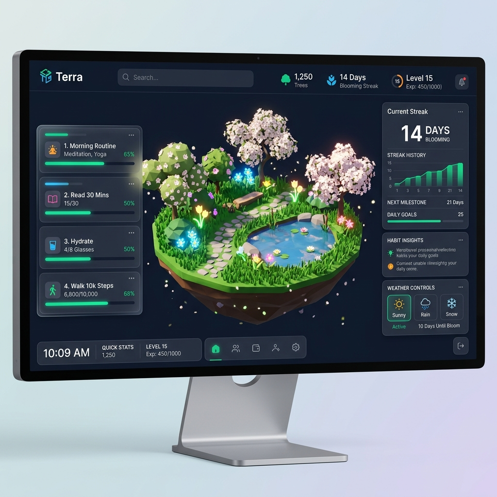
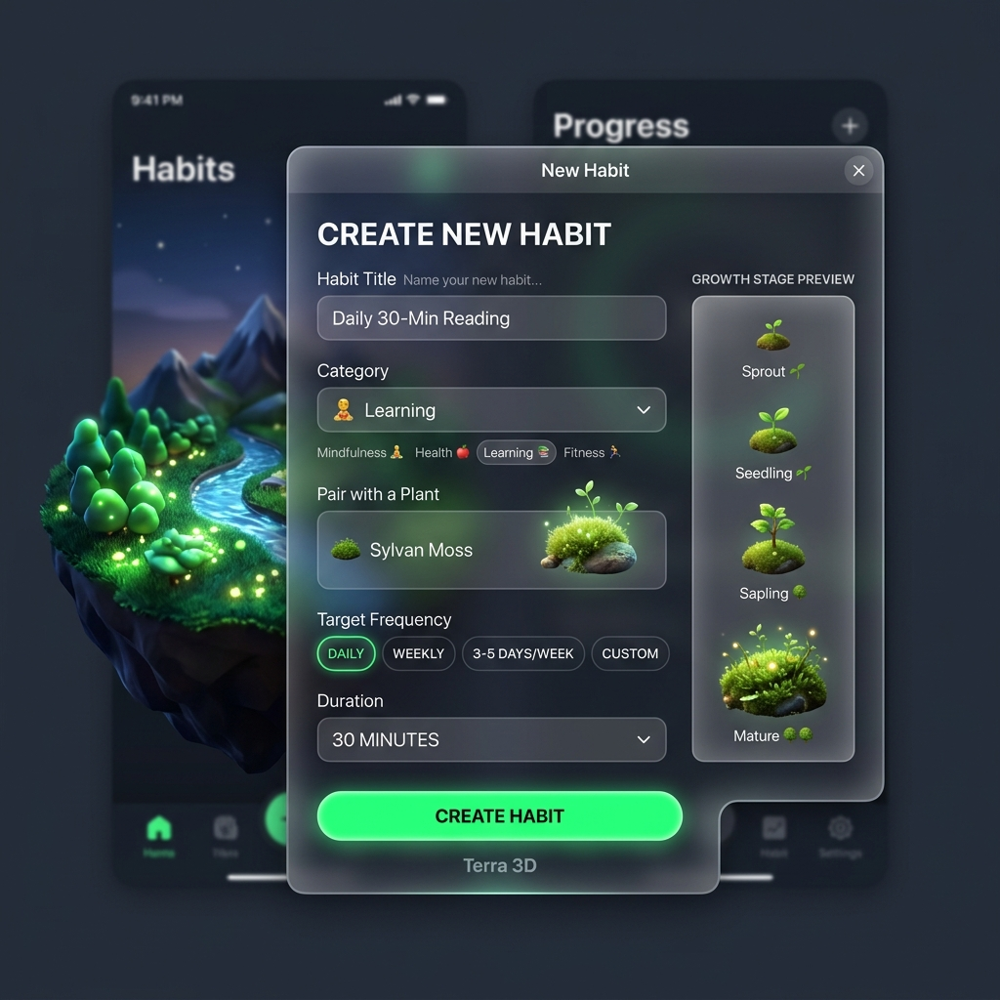
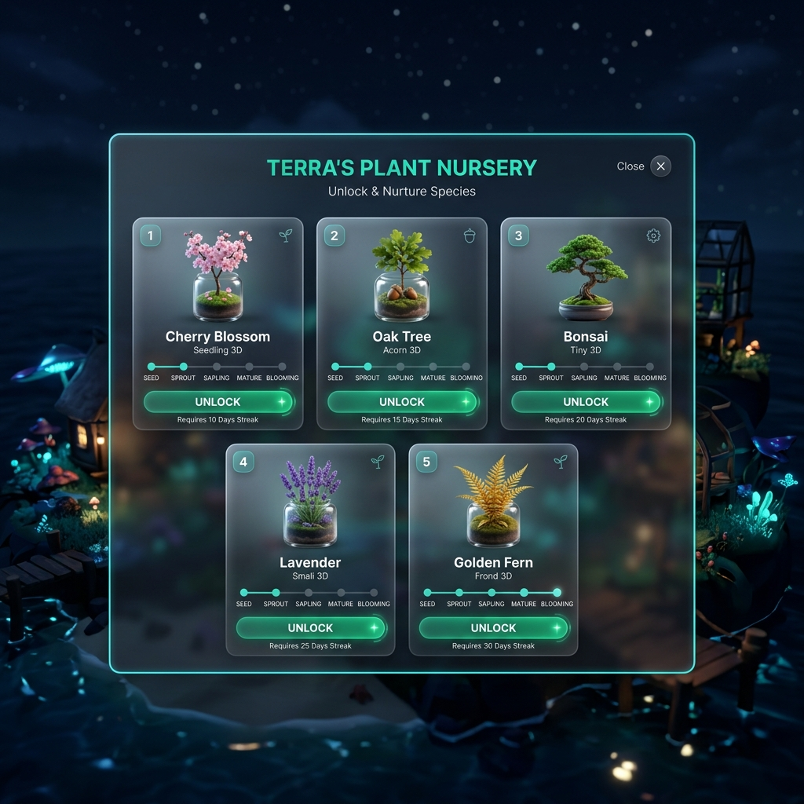
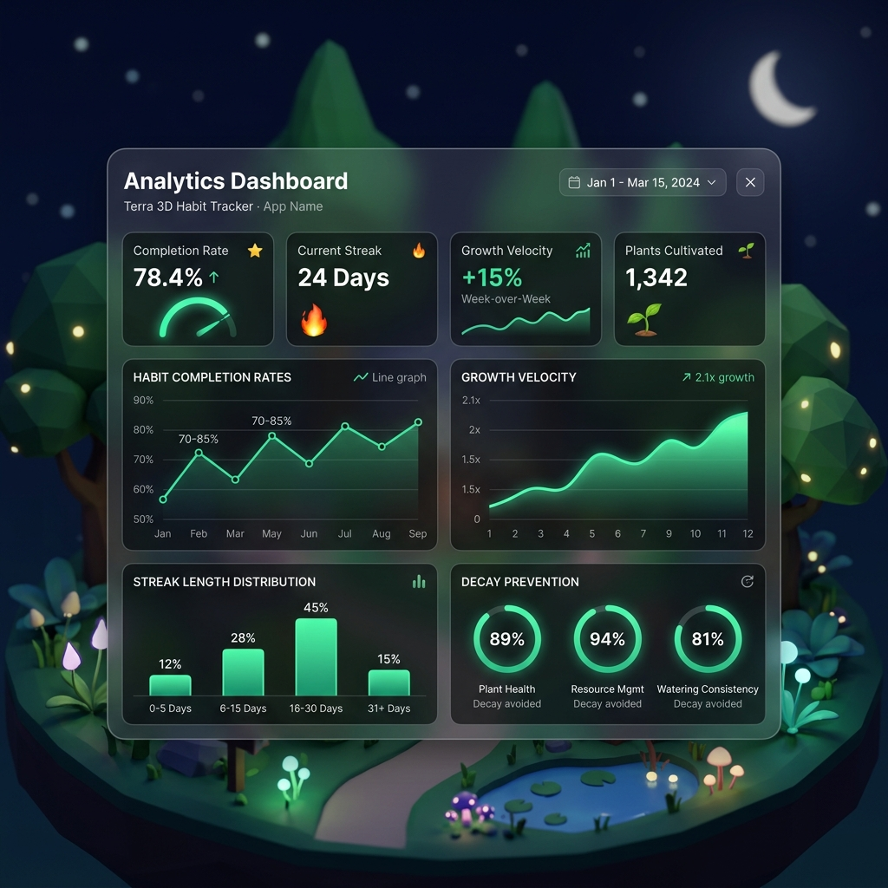
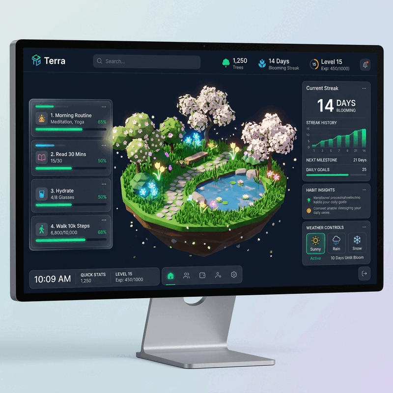

# Terra — 3D Habit Tracking Garden 🌳

[](https://github.com/AshcrestHQ/Terra/actions/workflows/ci.yml)
[](LICENSE)
[](https://nextjs.org/)
[](https://docs.pmnd.rs/react-three-fiber)
[](https://developer.mozilla.org/en-US/docs/Web/Progressive_web_apps)
[](https://terra.ashcrest.dev)

**Terra** is a 3D habit-tracking garden built with Next.js 14, React Three Fiber, Three.js, and Zustand. Every daily habit you keep nurtures a living procedural plant through five growth stages — **Seed**, **Sprout**, **Sapling**, **Mature**, and **Blooming** — set against a floating low-poly island scene with dynamic weather particle systems, streak tracking, analytics, and full PWA/mobile support.

---

## 🌟 Visual Showcase

<div align="center">

### Interactive 3D Island & Glassmorphic HUD


### Habit Creation & Management


### Plant Nursery Shop & Analytics Dashboard
<div display="flex" flex-direction="row" justify-content="center">
  
  
</div>

### Dynamic Weather & Island Rotation Demo


</div>

---

## 🏷️ GitHub Topics

`nextjs` • `typescript` • `threejs` • `react-three-fiber` • `habit-tracker` • `gamification` • `pwa`

---

## 🌐 Live Demo

Experience Terra directly in your browser:
👉 **[https://terra.ashcrest.dev](https://terra.ashcrest.dev)**

---

## 🏛️ Architecture & Component Flow

Terra combines a high-performance **3D Graphics Engine** in WebGL with a **2D Glassmorphic HUD** built on Tailwind CSS and Framer Motion, synchronized via state management stores.

```mermaid
flowchart TD
    subgraph Client ["Browser & Mobile Runtime"]
        PWA ["PWA Service Worker (sw.js)"]
        CAP ["Capacitor Native Shell (iOS / Android)"]
    end

    subgraph StateLayer ["State & Storage Layer"]
        STORE ["GardenContext & Zustand Store"]
        LOCAL ["LocalStorage Persistence"]
        DECAY ["Gamification & Streak Decay Engine"]
    end

    subgraph GraphicsEngine ["3D Rendering Pipeline (R3F / Three.js)"]
        CANVAS ["GardenCanvas Component"]
        ISLAND ["FloatingIsland 3D Mesh"]
        PLANTS ["3DPlants Procedural Loader & Stage Scaler"]
        WEATHER ["WeatherParticles System (Sunny, Rain, Snow)"]
        ORBIT ["OrbitControls & Camera Systems"]
    end

    subgraph UIHUD ["Glassmorphic HUD Overlays"]
        NAV ["Navbar Component"]
        LIST ["HabitList Component"]
        HMODAL ["HabitModal (Creation/Editing)"]
        NURSERY ["PlantNursery Shop Modal"]
        ANALYTICS ["AnalyticsModal Dashboard"]
        DETAILS ["PlantDetailsModal"]
    end

    Client --> StateLayer
    StateLayer <--> UIHUD
    StateLayer <--> GraphicsEngine
    STORE <--> LOCAL
    DECAY --> STORE
    PLANTS <--> STORE
    WEATHER <--> STORE
```

### Key Technical Subsystems

1. **R3F 3D Canvas (`components/canvas/`)**:
   - `GardenCanvas.tsx`: Initializes the WebGL canvas, lighting parameters, shadow maps, and OrbitControls.
   - `FloatingIsland.tsx`: Renders the low-poly floating island mesh, water pond shaders, and stone pathways.
   - `3DPlants.tsx`: Dynamically instantiates plant species GLTF models (`/public/models/`), scaling meshes continuously based on habit streak days.
   - `WeatherParticles.tsx`: GPU-accelerated particle system rendering dynamic rain drops, snow crystals, and sunny light shafts.

2. **Gamification & Decay Engine (`context/GardenContext.tsx`)**:
   - Calculates plant growth stages based on streak longevity:
     - `SEED` (0–2 Days) -> `SPROUT` (3–6 Days) -> `SAPLING` (7–13 Days) -> `MATURE` (14–29 Days) -> `BLOOMING` (30+ Days).
   - Enforces a health decay penalty when daily habits are missed, requiring consistency to maintain plant health.

3. **Glassmorphic HUD (`components/ui/`)**:
   - Translucent frosted glass panels created using backdrop blur utilities, Framer Motion transitions, and Lucide React iconography.

---

## 🎮 Growth Stage Thresholds

| Habit Streak | Growth Stage | Model Asset | Mesh Scale |
| :--- | :--- | :--- | :--- |
| **0 – 2 Days** | `SEED` | `/models/seed.glb` | `0.45x` |
| **3 – 6 Days** | `SPROUT` | `/models/sprout.glb` | `0.70x` |
| **7 – 13 Days** | `SAPLING` | `/models/sapling.glb` | `1.00x` |
| **14 – 29 Days** | `MATURE` | `/models/mature_tree.glb` | `1.35x` |
| **30+ Days** | `BLOOMING` | `/models/blooming_tree.glb` | `1.70x` |

---

## 💻 Local Development

### Prerequisites

- **Node.js**: `v20.0.0` or higher
- **npm**: `v10.0.0` or higher

### Steps

1. **Clone the repository**:
   ```bash
   git clone https://github.com/AshcrestHQ/Terra.git
   cd Terra
   ```

2. **Install dependencies**:
   ```bash
   npm ci
   ```

3. **Start Next.js dev server**:
   ```bash
   npm run dev
   ```
   Navigate to [http://localhost:3000](http://localhost:3000).

4. **Lint and Build verification**:
   ```bash
   npm run lint
   npm run build
   ```

---

## 📱 Mobile & PWA Support

### Progressive Web App (PWA)
Terra includes complete PWA manifest configuration (`public/manifest.json`) and an offline service worker (`public/sw.js`). Users can install Terra to their mobile home screen (A2HS) for offline habit tracking.

### Native Mobile App (Capacitor)
Terra is pre-configured with Capacitor for iOS and Android native deployment:

1. Compile static web bundle:
   ```bash
   npm run build
   ```
2. Synchronize native plugins:
   ```bash
   npx cap sync
   ```
3. Open in Xcode / Android Studio:
   ```bash
   npx cap open ios
   npx cap open android
   ```

---

## ⚡ Deployment

### Cloudflare Pages (Static Export)

Terra utilizes Next.js Static Site Generation (`output: 'export'` in `next.config.js`).

**Automatic GitHub Deployment:**
1. Connect your repository to [Cloudflare Dashboard](https://dash.cloudflare.com/) under **Workers & Pages**.
2. Select Framework Preset: **Next.js (Static HTML Export)**.
3. Set Build Command: `npm run build`.
4. Set Output Directory: `out`.

**Manual Deployment via Wrangler CLI:**
```bash
npm run build
npx wrangler pages deploy out --project-name terra
```

---

## 🌐 Browser & Hardware Requirements

| Browser / System | Minimum Supported Version | Hardware Requirement |
| :--- | :--- | :--- |
| **Google Chrome / Edge** | Version 90+ | WebGL 2.0 enabled |
| **Mozilla Firefox** | Version 88+ | WebGL 2.0 enabled |
| **Apple Safari** | macOS 12+ / iOS 15+ | WebGL 2.0 enabled |
| **Mobile Browsers** | Chrome Android / Safari iOS | GPU Hardware Acceleration |

> [!NOTE]
> Ensure Hardware Acceleration is enabled in your browser settings for optimal 60 FPS rendering of 3D weather particles and lighting.

---

## 🗺️ Product Roadmap

- [x] **Phase 1 (v1.0)**: Core 3D island rendering, basic habit streaks, local storage sync.
- [x] **Phase 2 (v2.0)**: Plant Nursery species shop, weather particle engines, analytics dashboard, Capacitor mobile support.
- [ ] **Phase 3 (v2.1)**: Custom WebGL shader effects for seasonal plant foliage and night fireflies.
- [ ] **Phase 4 (v2.2)**: Social garden visits & peer encouragement interactions.
- [ ] **Phase 5 (v3.0)**: WebGPU renderer migration for dense procedural forests and wearable companion apps.

---

## ⚠️ Known Limitations

- **Mobile WebGL Memory Limits**: Mobile devices with less than 3GB RAM may experience lowered particle counts during heavy weather storms.
- **Offline Sync**: Habit data is stored locally in `LocalStorage`; multi-device cross-cloud synchronization requires an active account backend (planned for v2.5).
- **Static Export Constraints**: Dynamic server-side API routes are disabled to ensure zero-cost static hosting compatibility on Cloudflare Pages.

---

## 🏷️ Release History

| Version | Release Date | Summary & Major Features |
| :--- | :--- | :--- |
| **`v2.0.0`** | Aug 08, 2026 | Next.js 14 App Router migration, Plant Nursery shop, dynamic weather, gamification decay engine, Capacitor support. |
| **`v1.0.5`** | Jul 28, 2026 | SSR hydration fixes and mobile gesture scaling polish. |
| **`v1.0.4`** | Jul 15, 2026 | Analytics modal integration and confetti celebration engine. |
| **`v1.0.0`** | May 10, 2026 | Initial public release of Terra 3D habit tracking garden. |

---

## 📄 License

Distributed under the MIT License. See [`LICENSE`](LICENSE) for more information.
